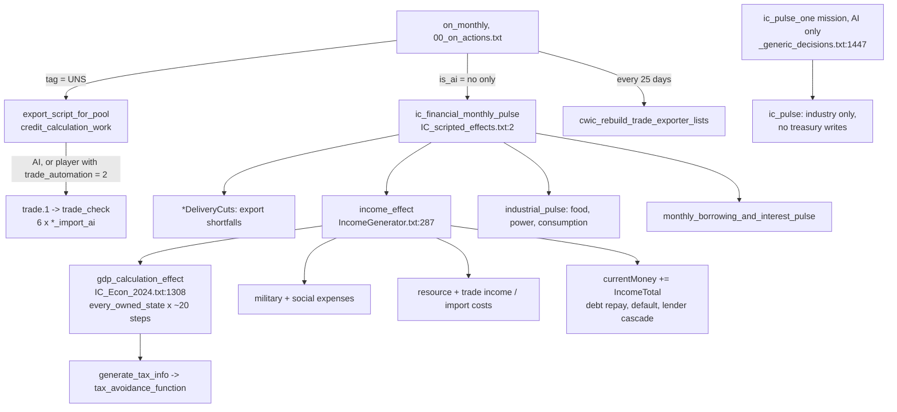

# CWIC Economy System: Overview and Audit

Branch `Econ-fix` at `b3d6f052f7` (merged with `development-branch` on 2026-10-27).
Paths are relative to `Cold War Iron Curtain/`. Detailed per-slice reports with full
data models and formulas are in `audit/`. Claims marked [INFERENCE] were read from
source but not observed in game.

## Fix status (2026-10-27, uncommitted on `Econ-fix`)

Engine rule used for every fix: in inline math, `max = X` is a floor and `min = X` is a
ceiling (developer-tested, `IC_Econ_2024.txt:2686-2687`). S2 was re-read under this rule:
the clamps are correct, and the real bug was the black-market leak's sign.

| Status | IDs |
|---|---|
| Fixed | S2 (leak sign), F1, F3, D1 (also in `IC_Economic_Scripted_Effects.txt`), D2, D3, D4, D5, B1, B3, B4, B7, P1, P4, P5, X1, X2, X3, T4, T5, T6, R3, R8, R9, R12, C1, C2, C3 (rounding only), C4, pollution health key, food export variable name |
| Reverted / re-adding one at a time | S3 reverted: running the world trade tick from another country's `on_monthly` inside `UNS = { }` made `ROOT` that country instead of UNS and caused a 10+ second stall every month (the world tick must stay in UNS's own `on_monthly`). Re-added: AI trade-capacity refresh (`cwic_ai_refresh_trade_capacity` in `trade_check`), pending stall test. Still out: R1 (AI multi-supplier buying), S1 AI money pulse. |
| Not real on re-read | P3 (gain is reset per state), R11 (`nuclear_total` is the running chromium tally; `nuclearImports` is written), T3, B6 (`totalexp` is read by GUI/COMECON) |
| Left by design | F2 (EEC/EFTA bonus kept), R4, R5, R7, R3 revive-or-cut decision, C3 balance constants |
| Deferred pending dev feedback | R1 AI multi-supplier buying (cheap variant: cheapest first, rest unsorted as fallback); AI money stipend (yearly base from engine factory counts, scaled monthly by economic modifiers, capped, paused while in debt, ceiling on hoarding). Today AI money is frozen at game-start levels apart from decision spending and player payments. |
| Deferred pending dev feedback | Replace the 60-day policy-change lock (`Recent_*_Change` flags, `Finance_Tab.txt`) with a political power cost. The 60-day lock is intentional (players disliked multi-year locks); tooltips updated to match. The `*_cooldown` ideas in `IC_Policies.txt` are defined but never applied. |
| Not done | Collapsing the copy-paste CG tier blocks and profiling (needs an in-game run); F4, F5, F6 |

Trade export and import settlement are `ic_calc_trade_exports` / `ic_calc_trade_imports`
(end of `IncomeGenerator.txt`), called from `income_effect`.

AI changes tried and removed: a light money pulse (staggered GDP/tax refresh plus monthly
trade settlement for every AI), a per-AI trade-capacity refresh in `trade_check`, and
cheapest-first multi-supplier AI buying. Any future AI economy work needs in-game profiling.

## 1. Architecture in one page

The economy is almost entirely scripted: per-country variables recomputed by
scripted effects on a monthly tick. Vanilla HOI4 resources and buildings are inputs;
money, GDP, taxes, debt and scripted trade are all variables.

### Subsystems

| Subsystem | Core files | What it does |
|---|---|---|
| Treasury and budget | `IncomeGenerator.txt` (`income_effect` 287-2920), `IC_scripted_effects.txt` | Nets income against expenses into `currentMoney`; debt service; deficit -> loans |
| GDP and population economy | `IC_Econ_2024.txt` | Per-state building counts, employment by class (9 pop types), productivity, gross earnings, wages, GDP |
| Production inputs | `IC_Industrial_Pulse.txt`, `Resource_Efficiency*.txt`, `CWIC_Enviroment.txt` | Resource/electricity/food consumption, farm output, pollution, shortages |
| Taxes | `policy_focus_effects.txt` (`generate_tax_info` 368), `IC_tax_avoidance_line.txt`, `IC_Laws.txt` | Four class tax brackets (tiers 1-19 at 5% steps) -> effective rate -> per-class take |
| Spending policies | `IC_Policies.txt`, `policy_focus_effects.txt`, `Finance_Tab.txt` | Welfare/health/education/policing/military spending tiers as ideas carrying `*_spending_modifier` |
| Economic system | `IC_Economy_Effects.txt`, `IC_Economic_System_Triggers.txt` | `economic_x_axis` / `economic_y_axis` position; special systems 20-28 (palace, feudal, rentier, petrostate, colonial, cartel, war economy) |
| Debt and credit | `IC_Loans_and_Interest_Rate_Effects.txt` | Credit rating 1-10, interest rates, 8 lenders, default/austerity |
| Scripted trade | `IC_Trade_Scripted_Effects.txt` (12.7k), `_Cuts.txt`, `CWIC_trade_exporter_lists.txt`, `consumer_goods_ai_automated_trade_effects.txt`, `Trade_Tab.txt` | Exporter registry, prices with shipping, contracts, AI import logic, export-cut shortfalls, consumer-goods tiers T0-T5 |
| UI | `Finance_Tab.txt`/`.gui`, `Trade_Tab.txt`, `line_graph_scripted_effects.txt` | Finance tab, loans window, sliders, 20-month history graphs |

### Monthly money formula (players)

`income_effect`, in order (`IncomeGenerator.txt`):

1. GDP and taxes (`gdp_calculation_effect`); consumer-goods tick.
2. Military cost: per-branch `calc_*` (`IC_Econ_2024.txt:1665-2010`), land/navy/air
   scaled by `global.GlobalDebit` 0.28, then ad hoc monthly divisors 1.5 / 2.5 / 2.25.
3. Social cost: welfare, healthcare, education, policing, public services, all scaled
   by `average_development` and class population.
4. Income: tourism (`x GlobalCredit 0.45 / 12`), resource and export income,
   consumer-goods exports; minus corruption, import costs, insurgency funding.
5. `currentMoney += IncomeTotal`; if negative, `pulse_deficit` drives default checks
   and then borrowing from the first lender with capacity (Reserve, World, Morgan,
   Paris, Barclays, Mitsubishi, Deutsche, Suisse).

## 2. Findings that matter most

Severity: **H** breaks a core loop, **M** wrong numbers or dead feature, **L** cleanup.

### Structural

| # | Sev | Finding | Evidence |
|---|---|---|---|
| S1 | H | **AI countries have no treasury simulation.** `ic_financial_monthly_pulse` is gated `is_ai = no`. AI only gets `ic_pulse` through the `ic_pulse_one` mission, which writes no money, income or debt. AI money moves only through decisions/events. AI still buys through `trade.1`, so AI imports have no budget consequence. | `00_on_actions.txt:38-41`; `_generic_decisions.txt:1447-1485`; `IC_scripted_effects.txt:84+` |
| S2 | H | **Tax avoidance is a no-op; collection is always 100%.** Inline clamps are inverted: `tax_efficiency_factor` gets `max = 0`, `tax_avoidance_slope` gets `min = 1` then `max = 0` (always 0), and `effective_tax_rate` ends `max = 0.01` then `min = 1`, so it is always 1. The `tax_avoidance_elasticity` modifier and black-market leakage therefore do nothing. [INFERENCE: assumes min/max apply in order as clamps] | `IC_tax_avoidance_line.txt:5-28`; `policy_focus_effects.txt:405-416` |
| S3 | M | **The whole world trade tick hangs on the UNS tag.** If UNS does not exist, no AI trade, no export pool, no credit calc. | `00_on_actions.txt:42-59` |
| S4 | M | **Three to four full `every_owned_state` passes per player per month** (`gdp_calculation_effect`, `industrial_pulse`, `industrial_pulse_food_script`, `resource_bonus_script`), plus the UNS export pool `every_other_country x every_controlled_state` and per-AI O(E^2) sort loops in trade. These are the main late-game lag suspects. | `audit/econ_production.md` 5; `audit/econ_trade.md` |

### Money and budget

| # | Sev | Finding | Evidence |
|---|---|---|---|
| B1 | H | Welfare spending modifier applied twice (`welfare_policy_mult` then `modifier@welfare_spending_modifier` again), so welfare tiers scale quadratically. | `IC_Econ_2024.txt:1537-1589` |
| B2 | M | Insurgency pulse zeroes `currentMoney` and `currentDebt` every month. | `CWIC_Insurgency_Economy_Effects.txt:46-47` |
| B3 | M | Navy cost clamp targets `air_army_expenditure`, so negative navy cost is possible. | `calc_navy_army_expenditure`, `IC_Econ_2024.txt:1879-1958` |
| B4 | M | Nuke x10 multiplies a temp variable that is never read. | `IC_Econ_2024.txt:1959-1991` |
| B5 | M | Military subsidy hard-codes `SOV.currentMoney` as payer. | `IncomeGenerator.txt:2003` |
| B6 | L | `totalexp` is computed and never read; `total_expenses` is the live one. `IncomeCheck` set twice. | `IncomeGenerator.txt:397-419, 2027, 2731` |
| B7 | L | `cwic_default_monthly_check` is dead (caller commented); the `ic_Financial` mission is `always = no`. | `IC_scripted_effects.txt:72`; `_generic_decisions.txt:1508-1541` |

### Production

| # | Sev | Finding | Evidence |
|---|---|---|---|
| P1 | H | **Dockyards earn nothing**: earnings multiply by `doc_productivity_factor_var`, whose only writers are commented out. | `IC_Econ_2024.txt:961-962, 1057` |
| P2 | M | Employment coefficients look swapped: arms factories use the office coefficient (x6) and dockyards the arms one (x0.35). [INFERENCE on intent] | `IC_Econ_2024.txt:513-525` |
| P3 | M | `oilEfficiencyGain` accumulates per state into a country variable. | `Resource_Efficiency_Bonus.txt` |
| P4 | M | `Privatisation_Level2` counted twice (+0.24). | `Resource_Efficiency.txt:144-164` |
| P5 | L | Possible divide-by-zero on `total_factory_amount`; `food_consumption_calculator` has no callers; agent-orange decay checks `napalm_total`. | `IC_Econ_2024.txt:922`; `IC_Industrial_Pulse.txt:2-170`; `IncomeGenerator.txt:25-40` |

On `development-branch`, the welfare policy tiers use `office_park_income_adjustment`, which has no definition anywhere. Only `office_park_income_bonus` exists, so those tiers' office-park effect is dead there. `Econ-fix` already has the fix (`IC_Policies.txt:1479+`).

### Taxes, laws, policies

| # | Sev | Finding | Evidence |
|---|---|---|---|
| T1 | H | See S2. | |
| T2 | M | `tax_avoidance_function` runs once before its input is set. Low impact because it reruns later. | `IC_Econ_2024.txt:1312` |
| T3 | M | `lower_tax_rate` also writes upper-class tax vars, so slider state can drift from the tier idea. | `policy_focus_effects.txt:3673-3690` |
| T4 | M | `decrease_DOM_Dominican_Nationalist_Fervor` defined twice; the second checks the wrong idea. | `policy_focus_effects.txt:6073, 6167` |
| T5 | L | `lower_healthcare_rate` bottom tier grants +50 political power. | `policy_focus_effects.txt:2152-2302` |
| T6 | L | Old Laffer curve cluster is dead, about 1,100 lines (`laffer_curve_function.txt` plus the `_gui` pair; the only entry, `laffer_curve_test`, has no caller), yet the Laffer GUI sampler still runs every pulse for every country. | `audit/econ_policy.md` |

### Trade

| # | Sev | Finding | Evidence |
|---|---|---|---|
| R1 | H | **AI buys from only the cheapest exporter per resource** and never splits a purchase, so it under-buys. | `IC_Trade_Scripted_Effects.txt:4506-4631` |
| R2 | M | `chromium_import_ai` writes `nuclear_total` (pending confirmation). Food = vanilla `rubber` and Rare Earth = vanilla `tungsten` are correct per `production_l_english.yml`. | `audit/econ_trade_ai_ui.md` |
| R3 | M | Resource concessions are effectively dead: the only live call is tutorial event `resource.1250`. Inside, chromium gains are subtracted from the aluminium target. | `resource_concession_evaluation.txt:172-230`; `events/tutorial.txt:129`; `IC_scripted_effects.txt:93` (commented) |
| R4 | M | `shipping_cost_effect` has no writer, and `price_adjust_oil/chromium/steel` have no writers. Shipping is pure distance, and those price levers are inert. | `IC_Trade_Scripted_Effects.txt:427` |
| R5 | M | `global_trade_bonus_adjustment` lowers the exporter's price (`x (1 - bonus)`), so a positive "trade bonus" cuts that country's export revenue per unit. It may be meant as competitiveness; it is a design decision. | `IC_Trade_Scripted_Effects.txt:403-410` (repeated about 19 times) |
| R6 | M | The Comecon `TRADE_COMECON_RATE` slider has no effect body. | `COMECON.txt:631-660` |
| R7 | M | `trade_automation` is never initialised; only the Trade tab writes it, so players default to manual trade. | `Trade_Tab.txt:1149-1165` |
| R8 | L | Shortfall events `trade.2`-`trade.7` each carry two `immediate` blocks (an empty one, then the live one). `trade.6`/`trade.7` are labelled "Nuclear Check" but run chromium and food. The food shortfall check at L158-166 uses `currentAvailableFoodExport` while everything else uses `currentAvailablefoodExport`. | `events/IC_Influence_events.txt:1-66`; `IC_Trade_Scripted_Effects.txt:158` |
| R9 | L | Dead or debug code: `startup_price_setting` (conflicts with live prices in `on_startup_defines.txt:2634-2659`), `price_Adj2`, `aluminium_test`, `exp_test`, `test_script`, `test_for_Trade_modifiers`. | `audit/econ_trade_core.md` |
| R10 | L | error.log: missing token `stabilizing_oil_prices`, invalid idea `Stabilizing_Oil_Prices` (`USA_Agnew_1980.txt:60`), `Revamped_Trade_Policy` OOS token warning. | `error.log` |

The exporter registry is rebuilt every 25 days, so it lags between rebuilds.

### UI

| # | Sev | Finding | Evidence |
|---|---|---|---|
| U1 | M | Graph normalisation divides by `max - min`; a flat history divides by zero. [INFERENCE] | `line_graph_scripted_effects.txt` |
| U2 | M | The "Electricity" graph stores `resource@coal`. | `line_graph_scripted_effects.txt:369` |
| U3 | L | `SAMPLE_*` graph effects are unreachable; duplicate economy tokens in `tokens.txt`; misspelled `modifier_tax_efficiacy`. | `audit/econ_ui.md` |

### Treasury flows (round 2)

| # | Sev | Finding | Evidence |
|---|---|---|---|
| F1 | H | **Import costs count only the first supplier.** Each import loop sets a temp guard (`food_import_check = 1` etc.) on the first element and never clears it; temp variables persist for the whole effect, so later suppliers are skipped. Applies to all 18 import loops. Importers underpay; exporters are still credited. | `IncomeGenerator.txt:1349-1869` (verified 1349-1402) |
| F2 | H | **Trade money is not conserved.** Exporter income is multiplied by `trade_credit_factor` (EEC +0.1, EFTA +0.25); importer cost is raw. Combined with S1 and F1, trade creates money for players and costs AI nothing. | `IncomeGenerator.txt:1207-1224, 1900-1909`; `IncomeGenerator_ideas_and_flags.txt:116, 122` |
| F3 | M | Insurgency funding is charged one month stale (subtracted at 1919, recomputed at 1924-1942). | `IncomeGenerator.txt:1919-1942` |
| F4 | M | `custom_expenses` is reset before being charged, so focus-added expenses between pulses are never paid; only reparations are re-added. [INFERENCE on intent] | `IncomeGenerator.txt:402-419, 1916` |
| F5 | M | War reparations: receivers' amount lands only in `trade_income` (never in `IncomeTotal`) and reads a variable written only in the payer branch; payers may be charged twice (`custom_expenses` and `IC_scripted_effects.txt:58`). [INFERENCE on double charge] | `IncomeGenerator.txt:402-419, 1185-1187`; `IC_scripted_effects.txt:58` |
| F6 | M | `custom_income` is permanent and PRC-only (focus writes, never reset). Soviet subsidy inputs `welfare_cost`, `cpi_cost`, `edu_cost`, `health_cost`, `pub_cost` have no writers. | `PRC_50s_New.txt:1364, 1380, 4871`; `IncomeGenerator.txt:1227, 1969-2008` |
| F7 | L | `fiscal_cor_loss` loc shows a rate (`CorruptIncomeLoss`) formatted as money. `trade_credit_factor <= 0` is reset to 1 (a default for unset; it also blocks a deliberate 0). | `CWIC_laws_l_english.yml:184`; `IncomeGenerator.txt:1192-1206` |

### Debt and credit (round 2)

| # | Sev | Finding | Evidence |
|---|---|---|---|
| D1 | H | **Interest is charged once, not per year.** `potential_loan_total = deficit x (1 + rate/100)` regardless of term, so a 35-year loan at 3.37% costs 3.37% total. Loans are near free. | `IC_Loans_and_Interest_Rate_Effects.txt:1486-1560` |
| D2 | H | **Repayments never restore Mitsubishi, Deutsche, Suisse or IMF capacity**: their branches all test `debtOwnerDomesticStatusArray^i = 4`, which Barclays matches first. | `IC_Loans_and_Interest_Rate_Effects.txt:1762-1865` (verified) |
| D3 | H | Lender cascade gates on static `*MaxBorrowable`; only `Current*` is decremented, so the gate never sees depletion. `Current*` caps are seeded once (tutorial event) and GDP refresh deltas are zero on repeat calls. | `IncomeGenerator.txt:2270-2600`; `IC_Loans...:1323-1436`; `events/tutorial.txt:32-62` |
| D4 | M | `domesticTotalDebt` only decrements (goes negative); `Credit_Progress = 0` after penalties wipes them; reserve inflation dampener multiplies `infl_premium` before assignment; paid debts are zeroed, not removed, so ledger arrays grow forever. | `IC_Loans...:1780, ~620-660, ~1206-1245`; `IncomeGenerator.txt:2117-2121` |
| D5 | M | Finance tab uses static Barclays cap where others use `Current*`; several focus scripts multiply principal by interest-like values. | `Finance_Tab.txt:2473`; `GDR_1960s.txt:2385, 2635`; `SWE_50s.txt:1608-1633`; `YUG_70s.txt:2909-2932` |

### Consumer goods (round 2)

| # | Sev | Finding | Evidence |
|---|---|---|---|
| C1 | H | `cwic_res_*_pool` adds the full `resource@X` (a current amount, not a monthly yield) every month and is never reset, so rare-resource caps and the tungsten gate grow without bound. | `IC_Consumer_Goods.txt:3145-3149` |
| C2 | H | Black-market stability penalty is subtracted into `CWIC_DM_CG_STABILITY_FACTOR`, which inflation then reads back as shortage pressure. | `IC_Consumer_Goods.txt:207`; `IC_Inflation_Effect.txt:90-94` |
| C3 | M | `cg_points_per_factory = 25` hard-set over config (comment says 10); demand factor is 0.0012 not 0.12 as commented; `round_variable` zeroes durable/vehicle/electronics demand for small countries. | `IC_Consumer_Goods.txt:3166, 818, 322-547, ~510` |
| C4 | M | About 480 lines of legacy coverage code never called; 23 near-identical ~171-line AI tier blocks; no electronics T0. | `IC_Consumer_Goods.txt:2260-2739`; `consumer_goods_ai_automated_trade_effects.txt:349-4111, 4282` |

### Taxes, systems, investments (round 2)

| # | Sev | Finding | Evidence |
|---|---|---|---|
| X1 | H | Each tax step effect ends `else = { add_political_power = 50 }` at floor/ceiling: free PP if the caller does not guard. [INFERENCE: caller guards unchecked] | `policy_focus_effects.txt:3816, 3960, 4108, 4252, 4400, 4544, 4692, 4836` |
| X2 | M | `startup_tax_loops` multiplies `*_startup_rate` by 8 in place (re-running compounds) and can add undefined `..._temp_0`. | `policy_focus_effects.txt:297-360` |
| X3 | H | `_modernize` / `_automate` investment decisions gate on `industrialization_budget` instead of their own budget. | `IC_Economic_Investments.txt:792-1444` |
| X4 | M | Leftover investment budget is refunded to `currentMoney`. `startup_economics` has no branch for systems 27/28; rentier/petrostate conversion skip it. `consumer_goods_need` steps +0.001 vs -0.01. `economic_modifier_state_development_cost` accumulates with no reader. `economic_z_axis` has no writer found. | `IC_flagbuildings_category.txt:133-518`; `IC_Economy_Effects.txt:36, 81, 156-353, 363-369, 606-651` |
| X5 | L | Duplicate steps in `US_HOUSE.txt` (21942, 21961, 27029, 27047); dead `get_actual_tax_rate_effect`, `give_everyone_base_tax`; write-only `*_class_tax_rate` vars; French loc keys `policy_taxrate_upper_middle_temp_*` match no idea. | `audit/econ_tax_policy_tiers.md` |

### Trade UI and Comecon (round 2)

| # | Sev | Finding | Evidence |
|---|---|---|---|
| R11 | H | `chromium_import_ai` stores and adds purchases to `nuclear_total`, which nothing reads; the import modifier reads `nuclearImports`. AI chromium purchases never take effect. | `IC_Trade_Scripted_Effects.txt:796, 845, 943` |
| R12 | H | Every `buy_*_click` writes the shared `currentAvailableChromiumExportPrompt`, so the buy prompt shows whichever resource was clicked last. `buy_steel_click`/`buy_chromium_click` skip the target-amount add the others do. | `Trade_Tab.txt:2252-2967` |
| R13 | M | Comecon level tables disagree (CON/PRO level 6 = 160, others 80); `comecon_gross_ratio_calc` has no caller found. | `COMECON_Effects.txt:56, 108, 160, 212, 263` |

### Modifier keys

A scripted sweep of every `modifier = { }` key in the economy idea files and every
key in the economy dynamic modifiers, checked against vanilla documentation, both
`modifier_definitions` folders, and building/ideology/resource templates, found no
confirmed undefined keys. `MONTHLY_POPULATION` (27 uses, e.g. `IC_Policies.txt:251`)
is uppercase but does not appear in error.log, so the engine probably accepts it [INFERENCE].
Separate scout findings:
- The pollution health penalty writes `health_spending_modifier`, but spending reads `healthcare_spending_modifier`, so the penalty is dead (`IC_dynamic_modifiers.txt:814` vs `IC_Econ_2024.txt:1600`).
- `modifier_arms_factory_income`, `trade_goods_cost`, `modifier_trade_efficiency` and `modifier_mass_media_spending` are defined but never read by script.

## 3. Assessment

The design is ambitious and mostly wired: class-based GDP, bracketed taxes, a loan
ledger, consumer-goods tiers and a contract-based trade market. The problems fall
into four groups:

1. **Half the world is not simulated.** AI has no budget loop (S1). AI trades but
   never pays, and trade itself mints money (F1, F2). Every balance number depends
   on fixing this.
2. **Money creation and missing sinks.** Near-free loans (D1), first-supplier-only
   import costs (F1), trade credit bonuses (F2), investment refunds (X4) and PP
   from tax steps (X1) all push money or PP up. Tax avoidance does nothing (S2).
3. **Silent math bugs that zero or inflate whole features**: dockyards (P1), double
   welfare (B1), chromium AI (R11), lender restoration (D2/D3), CG pools (C1).
   None show up in error.log.
4. **Cost and duplication.** Several full-state passes per player per month, the
   UNS world loop, O(E^2) AI sorts, 18 copy-pasted import loops and 23 copy-pasted
   CG tier blocks.

## 4. Suggested order of work

1. Decide S1: give AI a light money pulse (GDP, taxes, aggregated costs, no ledger)
   or keep AI money abstract and stop AI trade from depending on it.
2. Make trade and debt conserve money: F1, F2, D1-D3, R11.
3. Fix the remaining silent math: S2, P1, B1, B3, B4, C1, C2, X3, P3, P4, and the
   pollution health key.
4. Trade pass: R1, R4/R5 pricing levers, R7 default automation, R12 prompt, R3
   concessions revive-or-cut, de-hard-code the UNS host (S3).
5. Cut dead code: Laffer cluster (T6), legacy CG coverage (C4), trade test effects
   (R9), `Econ backup/`, dead missions (B7).
6. Collapse the copy-paste loops and profile the per-state passes (S4) once the math is stable.

## 5. Remaining gaps

All planned areas are now audited. Smaller unread ranges are listed in each `audit/`
report's open questions, chiefly:
- `IC_Consumer_Goods.txt:1999-2259` (writers of CG income/productivity modifiers).
- `IC_Loans...:1866+, 2090+`, `cwic_reserve_currency_update`.
- `CWIC_Econ_Change_scripted_effects.txt:63-182`.
- `policy_focus_effects.txt:5000-7506`.
- `zz_econ_laws.txt` and the `_economic.txt` modifier bodies.

These items need engine or in-game confirmation before fixing:
- Do inline `min`/`max` clamps apply in written order (S2)?
- Is `resource@X` a current amount (C1)?
- Does uppercase `MONTHLY_POPULATION` resolve?
- Is the tax-step PP actually reachable (X1)?

No in-game run was done; all findings are from source.
