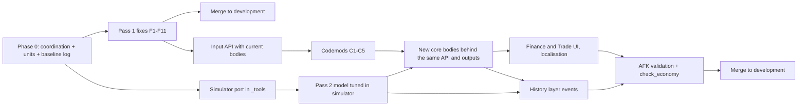

# CWIC economy rework plan

Status: draft for team review, 2026-11-02. Branch: `Econ-fix`, fast-forwarded to
`development-branch` at `c93c0cea1a`.

Inputs:
- `README.md` in this folder: the dependency map.
- The external stress test (Claude artifact `PBHbk5yy2PDZBAyoP75LtB`).
- Three read-only code audits made on 2026-11-02. Their findings are folded in below with `path:line`.

## 0. Decisions taken

| # | Decision | Choice |
|---|---|---|
| D1 | Depth | **Fixes first, then a new core.** Pass 1 fixes in place and merges to development early. Pass 2 replaces the core on Econ-fix. |
| D2 | AI | **One model for every country, monthly, the same as the player.** Changed on 2026-11-02 after Run B showed that the player pulse on every country costs about 3% of tick time at full speed (`baseline/runB_2026-11-02/NOTES.md`). The stipend, the territory-change GDP refresh and the yearly AI scheduler are dropped. |
| D3 | Money scale | **Fixed amounts** (revised 2026-11-02 after the smoke test). Content keeps its billion-denominated amounts and goes through `cwic_change_money`. GDP scaling was tried and dropped: 1949 GDP is not a valid reference for countries whose territory changes early (VIE ×33, PRC ×2.7), and it added complexity for little gain. |
| D4 | Debt | **One debt stock plus a lender list.** Content creates loans only through one take-loan effect. |
| D5 | Cut | Per-class pops, wages and conversions; the consumer-goods market; the CPI price index and inflation tiers; the Laffer/tax-avoidance curve; the 144 unreferenced definitions. |
| D6 | Branches | **Econ-fix is the rewrite branch.** Economy core changes go there; development only receives merges. |
| D7 | GDP-scaled amounts | Withdrawn with D3. |
| D8 | Lenders | **Keep every lender distinct:** Domestic Reserve, Domestic Commercial, BNP, Barclays, Chiyoda-Mitsubishi, Credit Suisse, Deutsche, JPM, IMF, World Bank, plus country lenders. |
| D9 | History layer | **Part of this rework (Pass 2, §4.1 item 9).** It is not deferred to a later content pass. |
| D10 | Debt on territory change (F14) | **Debt follows the GDP.** A country losing states hands the share of its debt equal to the share of GDP lost to the new owner. This follows state-succession practice: Austria-Hungary's and the Ottoman debt were apportioned to successors, as were the Raj's at partition. **Exception:** a hostile or revolutionary taker repudiates the inherited share, as the PRC did with ROC debt in 1949 and the Soviets with Tsarist debt. Then the debt is written off and the creditors lose it. |

Clarification on D5. The `cpi` in `increase_cpi_policy` / `policy_cpi_temp_N` means
**Civil Protection and Intelligence**, the policing policy (`IC_Policies.txt:1742`).
It is not inflation and it stays. What gets cut is `CWIC_cpi_index`, the inflation
price index (`IC_Inflation_Effect.txt:200-224`), and `cwic_inflation_tier_monthly_assign`.

## 1. Working agreement

- afushin made 20+ economy commits between 10-20 and 11-02 (Finance window, crisis levers,
  capital controls, money printing, FX reserves, lender caps, the AI stipend, the AI GDP refresh).
  **Before Pass 2 starts:** agree in writing that core files (§2.3) change only on Econ-fix, and
  that Finance/Trade UI work during Pass 2 also lands on Econ-fix.
- Merge `development-branch` into Econ-fix weekly. Merge Econ-fix into development
  at the end of Pass 1, and again at the end of Pass 2.
- Nothing is pushed without the team seeing the diff.

## 2. The boundary

### 2.1 Published outputs

The new core must keep these names and meanings. Anything not listed is internal and may be removed.

| Variable | Scope | Unit | Cadence | Read by |
|---|---|---|---|---|
| `grossdomesticproduct` | country | money unit per year (§2.4) | monthly for every country | macro crisis, influence, logging, division limits, NATO scorer, Capital Controls, French effects, Crisis Manager |
| `grossdomesticproductcapita` | country | money per person | same | logging, Finance UI |
| `CWIC_gdp_growth_yoy`, `CWIC_real_gdp_growth_yoy`, `CWIC_gdp_growth_mom_annualized` | country | fraction | same | macro crisis |
| `National_HDI` | country | 0–1 | same | logging, MNC, separatism, SOV focuses |
| `State_HDI`, `state_development` | state | 0–1 / tier 0–5 | same | environment, MNC, separatism, religion GUI, map mode, pops |
| `currentMoney` | country | money unit | monthly for everyone | 56 readers |
| `currentDebt` | country | money unit | monthly | macro crisis, logging, influence GUI |
| `currentDebtPayments` | country | money per month | monthly | macro crisis, Crisis Manager |
| `cwic_monthly_balance` (**new**; replaces `pulse_deficit` for readers) | country | money per month | monthly | macro crisis, Crisis Manager |
| `Credit_Rating` | country | 1–10 | monthly | IMF, macro crisis, localisation |
| `Interest_Rate` | country | **percent per year** (§3, F1) | monthly | macro crisis, Finance UI |
| `CWIC_inflation_mom` | country | fraction per month | monthly | Capital Controls, IMF, macro crisis, logging, decision categories |
| `CWIC_black_market_pressure`, `CWIC_fx_reserves`, `CWIC_fx_regime`, `CWIC_reserve_*` | country | as today | monthly | Capital Controls, macro crisis (afushin's systems; kept) |
| `CorruptionLevel` | country | as today | static | 35 files |
| `literate_/primary_/high_school_/college_educated` | state | share | monthly | history (about 2,090 files), YUG/INO content |
| `economic_x_axis`, `economic_y_axis` | country | grid | on change | MNC, Resource_Efficiency, startup |
| Resource balances: `*_consumption`, `*Export`, `*Imports`, `*_resource_bonus`, `FoodBalanceTotal`, `food_penalty*`, `electricity_*` | country | as today | monthly | dynamic modifiers (54 + 29 refs), macro crisis, Trade tab |
| `cg_shortage` (**new**, 0–1) | country | fraction | monthly | inflation, stability, Trade tab (replaces the consumer-goods matrix) |
| `CWIC_nationalization_pressure_index`, `CWIC_corporate_risk_index`, sector output indices | country | as today | monthly | MNC |

Gone, with consumers rewritten:
- `pop_*_gross_wage`, `national_total_*_class_*`, `class_pop_total_*`, the `cgBasic/Durable/Vehicles T0–T5` variables, `CWIC_cpi_index`;
- `debtTotalsArray`, `debtOwnerArray` and `debtPaymentArray` as content-writable structures (§2.2).

### 2.2 Input API: the only ways content may change economy state

| Effect | Replaces | Contract |
|---|---|---|
| `cwic_change_money` (existing) | 129 files of raw `currentMoney` writes | Input `money_change_temp` (fixed amount, billions; D3). Writes money and the tooltip. A spend beyond the treasury borrows through the lender cascade, never a silent negative. |
| `cwic_take_loan` (**new**) | about 10 files hand-building debt arrays and `pulse_deficit × Interest_Rate` maths | Inputs: fixed amount, lender id (1–10, plus a country lender via `cwic_loan_lender` scope), term, optional rate. Adds to debt and the lender list, and pays the creditor. |
| `cwic_forgive_debt` / `cwic_restructure_debt` (**new**) | debt edits in GDR/SWE/YUG/FRA/VIE content | Reduce debt, optionally for one lender. |
| `increase_/decrease_<policy>` setters (existing names; new bodies) | about 55 files that add or remove `policy_*_temp_N` ideas directly | Policy level becomes the source of truth (`*_level_value`). Ideas are derived from it. Raw idea edits get a codemod onto the setters. |
| `cwic_set_policy_level` (**new**) | jumps of several levels in content | Sets level N directly. Needed for the codemod. |
| `step_towards_*`, `convert_to_*` (existing, afushin) | 11 files writing the axes raw | Codemod raw axis writes onto these. |
| `cwic_change_corruption` (**new**) | raw `CorruptionLevel` writes in 34 files | Clamped, logged. |
| `cwic_change_education_share` (**new**) | raw education-share writes (INO ×3, TUR, YUG, Indonesia events) | State or country scope, clamped, keeps the shares ordered. |

### 2.3 Core files: owned by the rewrite and replaced in Pass 2

`IC_Econ_2024`, `IncomeGenerator*` (3), `IC_Economic_Scripted_Effects`, `IC_Economy_Effects`,
`IC_Financial_Scripted_Effects_for_Content`, `IC_Industrial_Pulse`, `IC_Inflation_Effect`,
`IC_Loans_and_Interest_Rate_Effects`, `IC_Consumer_Goods`, `consumer_goods_ai_automated_trade_effects`,
`IC_Trade_Scripted_Effects(_Cuts)`, `CWIC_trade_exporter_lists`, `CWIC_Goods_Generated_Effects`,
`IC_literacy_calculations`, `IC_tax_avoidance_line`, `PolicyCostCalculator`, `StartupMoney`,
`policy_focus_effects` (economic setters and startup), `CWIC_GDP_Growth_Effects`, `CWIC_Employment_Init`,
`Employment_Effects`, `IC_State_Decisions_Effect`, `CWIC_state_category_cache`, `IC_scripted_effects`
(the financial pulse part), `events/Economic_Penalties`, the economy blocks of `on_startup_defines`,
and the scripted triggers `IC_Economic_System_Triggers`, `IC_spending_level_triggers`, `IC_Pops_Triggers`, `cwic_cg_unlocks`.

### 2.4 Units (confirmed by the team, 2026-11-02)

- `currentMoney`: billions (1 = 1 billion).
- `grossdomesticproduct`: billions per year.
- `Interest_Rate`: percent per year. Loans already read it that way (`IC_Loans_and_Interest_Rate_Effects.txt:1519-1569`); the rating table gives 1.01–1.5 (`:1060-1261`). The inflation pulse is the one reader that gets it wrong (F1).

## 3. Pass 1: fixes in place

Every item has a location and an acceptance check. The check runs through the existing
`CWIC_ECON` yearly log and `_tools/economy_check/check_economy.py`, plus console scenarios
in `Indochina_Test_Effects`-style test effects (an economy test section; no new file per test).

| # | Fix | Location | Acceptance |
|---|---|---|---|
| F1 | Inflation tightening reads `Interest_Rate` as 1 + r. Use the percent: `tight = max(0, Interest_Rate − neutral_rate) / 100 × k`. | `IC_Inflation_Effect.txt:132-136` | A debt-free country with rating 5–7 has inflation ≥ 0 after 5 years. |
| F2 | Upgrade-cost blocks multiply `UPC_popN` again instead of `UPC_popNdevK`. | `on_startup_defines.txt:3104-3155` | Dev-1 to dev-5 costs scale with population tier; dev-0 is multiplied once. |
| F3 | The market multiplier `if`s stack (x 13–18 gets ×1.75 × ×1.5). Use `else_if`. | `IC_Econ_2024.txt:973-998`, `1004-1030` | Civilian multiplier is 1.75 for x 13–18, 1.5 for 7–12, 1.25 for ≤6; same for office parks. |
| F4a | The default farm loop tests `industrial_complex` but removes `agri_industrial_complex`. | `events/Economic_Penalties.txt:~159-175` | Removes farms only where farms exist. |
| F4b | The default policy reset misses levels (education 2 and 5+, welfare, healthcare, services), leaving old ideas stacked with `temp_1`. Use one generic remover per policy. | `Economic_Penalties.txt:~200-276` | After a default, exactly one idea per policy family. |
| F5 | Default becomes restructuring: no building demolition. Debt is halved, tax policy is left alone, social policies drop by 2 levels, `Recent_Default` stays. | `IncomeGenerator.txt:793-819`, `Economic_Penalties.txt:53-194` | India/Egypt/Brazil/Poland at startup policies keep or gain factories after a default. |
| F6 | Wage-priced services (proposal A): multiply welfare, healthcare, policing and education cost by `min(1, gdp_per_capita / ref)`, with ref ≈ US 1949. | `IC_Econ_2024.txt:1532-1640` | India's first-year spending is under 3× taxes, not 7×. The US, UK, FRA and WGR are unchanged (±2%). |
| F7 | Education trap: startup education level is at least 6, and the low-education penalty scales with the shortfall instead of a flat −0.007 per tier per state. | `policy_focus_effects.txt:~7765-7773`, `IC_literacy_calculations.txt:35-37, 87-89, 141-143, 193-195` | India and Egypt literacy rises over 1949–1959. |
| F8 | Six 1949 unit types have no upkeep: `strat_bomber`, `tank_destroyer`, `heavy_tank_destroyer_brigade`, `recon_armored`, `auto_cannon_support`, `direct_fire_gun_support`. | `IC_Econ_2024.txt:1657-1803` | Soviet and US military spending rises; the strategic-bomber line is non-zero. |
| F9 | AI parity: make the Run B switch permanent. `ic_financial_monthly_pulse` runs for every non-insurgent country, and `cwic_ai_money_stipend` and `cwic_ai_refresh_gdp_on_territory_change` are deleted. This also covers AI debt service: in Run B, ENG's debt went 2,210 → 508 and USA's 8,101 → 3,030. **Land last in Pass 1, after F5–F7, F10 and F15**, or the AI inherits the spiral (Run B: 16 of 36 larger countries above 150% debt/GDP). | `00_on_actions.txt:42-61`, `IC_scripted_effects.txt:71-140` | Every country's GDP and HDI move monthly. The Run B debt list shrinks to ≤ 3 countries above 150% by 1960. Tick time stays within 5% of Run A (398 s per game year). |
| F15 | The AI does not run its budget: it sits at startup policies and borrows automatically forever (RAJ debt 164 → 29,780 by 1960). Add a yearly AI fiscal rule: in deficit, raise tax one step (to a cap set by the economic system), then cut services, welfare and the military one step; in surplus, reverse. Use the existing setters, so the PP cost and ideas stay consistent. | new section in `IC_Economic_Scripted_Effects.txt` (AI budget), called from the yearly tick | No AI country runs a deficit for more than 3 consecutive years at startup policies in the simulator and in a Run B repeat. |
| F14 | Losing territory keeps all the debt: CHI's GDP 203 → 0.184 with debt 63.4 (34,476%), MAL 437,400%. Apply D10 (debt follows GDP; repudiated when the taker is at war with the loser). | the monthly pulse: compare GDP kept on retained states (`CWIC_GDP_Growth_Effects` already tracks this) with last month's | No country above 300% of GDP after a territory change; the PRC gains no ROC debt. |
| F10 | Negative money is free: reaching the debt check must not depend on accepting a loan. Fold negative `currentMoney` into the default and austerity comparison. | `IncomeGenerator.txt:586-599, 786-824` | A player who declines loans hits austerity at the same deficit as one who borrows. **Check the decline path first** (`bank_name_prompt` flow). |
| F11 | Delete `cwic_inflation_tier_monthly_assign` and its `on_actions/CWIC_economic_cache_compatibility.txt:7` and `_tools/check_economic_idea_cache.py:96` references. | `IC_Inflation_Effect.txt:314+` | Nothing references it. |
| F12 ✅ | HOI4 has no `on_yearly`, so the economy log, `cwic_update_yearly_gdp_growth` (macro-crisis GDP growth inputs) and the SDI yearly check never ran. Replaced with a per-country yearly tick in `on_monthly`, guarded by `cwic_last_yearly_tick = global.year`. **Done 2026-11-02** (found in Run A). | `on_actions/CWIC_Economy_Log_on_actions.txt`, `SDI_on_actions.txt` | `CWIC_ECON` lines appear for every country every year; `CWIC_gdp_growth_yoy` is non-zero after 1950. |

### Pass 1 implementation status (2026-11-02, not yet tested in game)

| # | Status | What was done |
|---|---|---|
| F1 | done | `IC_Inflation_Effect.txt`: tightening = (Interest_Rate − 1 point) × 0.000833 per month, cap 10 points. A 1-point-above-neutral rate now lowers inflation by about 1%/yr instead of 15%/yr. |
| F2 | done | `on_startup_defines.txt`: the dev-1 to dev-4 blocks multiply `UPC_popNdevK`. |
| F3 | done | `IC_Econ_2024.txt`: the middle band is x 7–12, so bands no longer stack. **Balance change:** x 13–18 economies (USA, CAN, WGR, BRA…) go from ×2.625 to ×1.75 on civilian factories, and ×3.135 to ×1.9 on office parks. Watch the rich countries' growth in Run C. |
| F4 + F5 | done | `events/Economic_Penalties.txt` .2: no demolition. Every loan, `currentDebt`, `currentDebtPayments` and `domesticTotalDebt` are halved. Welfare, healthcare and services −2, education −1 and union −2 go through the setters, so levels and ideas stay in sync; women +1 also goes through a setter. Tax is untouched. Recent_Default, IMF influence, SAP flag, devaluation, `gen_materialist_2` and `free_trade` are kept. New tooltip `CWIC_ECON_DEFAULT_RESTRUCTURE_TT`. |
| F6 | done | `IC_Econ_2024.txt`: `cwic_calc_wage_price_factor` = clamp(GDP per head / 42.04, 0.05, 1), with 42.04 = USA 1949. It multiplies the welfare, healthcare, policing (excluding black ops) and education costs. |
| F7 | done | Startup education is at least level 6 (`policy_focus_effects.txt`). The penalty is `−0.12 × max(0, 0.06 − education_gain_rate)`, computed once per country in `monthly_education_pulse` (`cwic_edu_penalty`) and applied in all four tiers. |
| F8 | done | Upkeep added: the five land types in their weight buckets, and `strat_bomber` in air tier 4. |
| F9 | done | `00_on_actions.txt`: `ic_financial_monthly_pulse` for every country. The Run B switch, `cwic_ai_money_stipend` and `cwic_ai_refresh_gdp_on_territory_change` are deleted. |
| F10 | **dropped** | Not reproducible: every negative month calls `automatic_loan_setting` (`IncomeGenerator.txt:1198`), with the IMF as the last-resort lender, so money cannot stay negative and there is no "refuse loan" path. |
| F11 | done | Deleted the tier function, the `cwic_inflation_env_*` set/remove/clear effects, the 13 `CWIC_infl_env_*` ideas (`IC_Laws_Country.txt`) and their English loc. Also removed the startup cache clear, the tool fixture and the two debug-tooltip lines. `_tools/check_economic_idea_cache.py` passes. |
| F12 | done | The yearly tick (Phase 0). |
| F14 | done | `cwic_transfer_state_debt` (`IC_Loans_and_Interest_Rate_Effects.txt`), called from `cwic_track_state_gdp_for_growth` when a state's remembered owner changes. The state's GDP share of each of the old owner's loans moves to the new owner (same lender, status and interest). The share is written off if the new owner is at war with the old one or the old one has capitulated (D10). |
| F15 | done | `cwic_ai_fiscal_rule` (`IC_Economic_Scripted_Effects.txt`), called yearly for AI countries. In deficit: raise tax to a cap by system (planned 16, state-directed 14, market 12, rentier 8); at the cap or above 60% debt/GDP, cut services, welfare and healthcare (floor 3) and army (floor 2, not at war). In surplus above 0.2% of GDP per month and below 40% debt/GDP: raise education to 12, then welfare to 10, then healthcare to 10. |
| F14 fix | done (after Run C) | `save_temporary_event_target_as` does not exist in HOI4 (877 errors in Run C, so transfers wrote the debt off). Replaced with `save_event_target_as`. |
| F16 | done (after Run C) | Inflation: shortage weight `k_sp` 0.020 → 0.006 (a full shortage now adds ~7%/yr, not ~24%). With F9, every AI country runs the consumer-goods tick, and shortage was the only term large enough to explain the 7.2%/yr median. The components are stored as `cwic_infl_sp/fp/dp/td/expect`. |
| F17 | done (after Run C) | Land-army upkeep × (0.3 + 0.7 × wage factor): personnel at local wages, 30% equipment at world prices. Targets the PRC/CHI spiral (absolute battalion costs against GDP per head ~1% of the USA's). Air and navy unchanged. |
| F18 | done (after Run C) | F15's surplus branch is stricter: surplus > 0.5% of GDP per month, debt < 30%, caps education 10, welfare and healthcare 8. Targets the Nordic drift into deficit after 1955. |
| Diagnostics | done | Yearly `CWIC_BUDGET` line per country: income, balance, debt service, land/welfare/education/healthcare cost, the four policy levels, wage factor, and the inflation components. |

Pre-existing issues seen while editing, not fixed:
- `lower_tax_rate` subtracts 0.05 from `upper_class_tax_rate`, but `increase_tax_rate` never adds it back (`policy_focus_effects.txt:3685-3700` vs `3829-3841`).
- Content that hand-builds loans (GDR, SWE, YUG, FRA, influence) appends to only some of the five debt arrays, so array indices can misalign. Pass 2's `cwic_take_loan` replaces this.

Not in Pass 1, because Pass 2 replaces it: consumer-goods AI buyers, `export_script_for_pool`
using a stale `oil_consumption`, the Laffer clamp order, class wages mixing gross and net in GDP.

Data questions, owned separately:
- Japan's 1949 tech set (`history/countries/JAP - Japan.txt:31, 381, 1257, 1430`); count the active techs.
- Starting literacy for Brazil (74% against 48% historical) and Iraq.
- Startup GDP per head for the 35 of 53 countries outside 1.5× of Maddison (`check_economy.py` output).

Pass 1 exit criteria:
- The `check_economy.py` 1949 snapshot and a 10-year AFK run show 0 defaults in the
  stress-test 15 at startup policies.
- Inflation sign is plausible.
- The AI GDP log moves.
- Merge into development.

## 4. Pass 2: new core

### 4.1 Model, per country

1. **State output.** `state_gdp = Σ_sector buildings × sector productivity × employment factor`.
   - Sectors: farms, civilian factories, office parks, arms factories, dockyards, resources and refineries.
   - Productivity = base × tech multiplier × schooling factor (`1.10^years_of_schooling`, derived from the
     four education shares) × system multiplier (one table on x/y) × electricity factor.
   - Employment factor: `min(1, state workforce / slots × labour per slot)`, with workforce from population and tier.
   - No class conversions.
2. **National.**
   - `grossdomesticproduct = Σ state_gdp`, and GDP per head.
   - HDI from income (log GDP per head), education (the shares) and health (life expectancy, Preston-style curve).
3. **Budget.**
   - Revenue = GDP × tax level × tax efficiency (efficiency = f(corruption, bureaucracy)).
   - Each social line costs **GDP × level × coefficient**, so costs scale with income, not head count.
   - Military is priced per unit (the F8 list included). Debt service comes from the lender list.
   - Ledger lines stay as named outputs for the Finance tab.
4. **Debt.**
   - One `currentDebt` stock, plus the lender array (id, principal, rate, remaining months) behind `cwic_take_loan`.
   - A deficit borrows automatically from the cheapest lender with capacity.
   - Spreads rise smoothly with debt ÷ GDP and fall with rating.
   - A crisis means restructuring (F5), never demolition.
5. **Inflation.**
   - Monthly rate = world regime baseline (Bretton Woods, the 1970s, disinflation) + money-printing and deficit pressure + `cg_shortage` − tightening.
   - Keep afushin's capital controls, FX and black-market levers on that rate.
   - No CPI index; logging keeps a YoY rate.
6. **Education.**
   - Enrolment spreads from policy level and HDI at a capped rate (about 2.5% of population a year), so the adult stock moves slowly.
   - Penalty only below a floor, scaled by the shortfall.
7. **Population tiers.** Wire `state_population_category_check` (`IC_Flag_Building_Effects.txt:1445`) yearly, so growing states gain slots.
8. **Consumer goods.** One `cg_stock` / `cg_demand` / `cg_shortage` per country. The AI participates through the same balance.
9. **History layer.** Global shocks and per-country path events, as the stress test modelled them. They are built as events and decisions in the rework's own files, not as formula terms.
   - **Global shocks** fire on their date for every country meeting the condition:
     - the 1958 world recession hits open economies;
     - the 1973 and 1979 oil shocks hit oil importers, and oil exporters gain;
     - the 1981 rate shock and sudden stop hit countries above a debt ÷ GDP threshold;
     - planned economies stagnate from 1965 until a reform flag is set.
   - **Path events** are the historical branch of a choice that content already offers, so a different path avoids them:
     - China: Great Leap, Cultural Revolution, 1978 reform. The reform needs a real growth mechanism (rural/coastal boom), not only removing stagnation.
     - Poland: Gierek borrowing, martial law. Brazil: II PND borrowing.
     - Iran–Iraq war; Suez closure; Japan's Korean War procurement and MITI.
     - Iraq's 1978 literacy campaign.
   - **Hooks:** existing focuses and events set flags (for example "took Gierek loans") that the shock conditions read. The macro-crisis system reacts to these shocks the same way it reacts to the others.
   - **Calibration:** in the simulator, the history layer was the largest single improvement (GDP error 1.31× → 1.22×). Each event is tuned there first.

Cadence:
- Every country, monthly, the same pulse (D2).
- Performance budget: a 10-year AFK run stays within 10% of Run A's 398 s per game year.

### 4.2 Removal list
- Class pops and wages: `IC_Econ_2024.txt:493-664, 1231-1306`, `Employment_Effects.txt:1735-1756` aggregates, `CWIC_Employment_Init.txt`.
- The consumer-goods T0–T5 matrix and `*DeliveryCuts`.
- `CWIC_cpi_index`.
- `IC_tax_avoidance_line.txt`, `generate_tax_info` 4-way averaging, the per-class tax setters.
- `PolicyCostCalculator.txt`.
- The 144 unreferenced definitions (`unreferenced_core_definitions.csv`). Re-check against Econ-fix HEAD first: afushin's `convert_to_*` commit may have made some of them live.

### 4.3 Consumers that need rewrites, not just adapters

| Consumer | Change |
|---|---|
| `Finance_Tab.gui:84-205, 493-529` | class pie charts → sector output and budget-ledger charts |
| `Finance_Tab.gui:5070-5083` | Laffer readout → tax efficiency |
| `Trade_Tab.gui:84-114, 1029-1117` | consumer-goods matrix → one balance and shortage |
| `money.gui:1721-1773` (state development) | read the tier value |
| `CWIC_GDP_Growth_Effects.txt:31-36`, `DDR_Map_Effects.txt:603-608`, `IC_Indonesia_Effects.txt:351-356`, `IC_Malaya_Effects.txt:161-166` | `state_gdp` from the new output |
| `IC_Pops_Triggers` level checks used by environment, religion, influence, SOV decisions, map mode | one state tier value; keep the trigger names as thin wrappers |
| `influence_scripted_diplomatic_actions` debt arrays | `cwic_take_loan` with a country lender |
| `IMF_effects` / `IMF_Decisions` | `Credit_Rating` and loans through the API; tax-policy idea checks → levels |
| `CWIC_Insurgency_Economy_Effects` | writes every policy level and debt directly → API |
| `Yugoslavia_Regional_Economic_Funding` (643 refs), `CWIC_GDR_Card_Game_Effects` (242 literals), `events/CWIC_Space` (396 literals) | money codemod, reviewed by hand |
| `weapon_purchasing_*` (6 files, 1,036 subtractions) | keep absolute prices through `cwic_change_money` |
| `EastGermany.gui:833,844` | `total_national_pop_uni` → population output |
| Localisation: 243 `[?var]` reads in 19 files | re-point to the published outputs |

### 4.4 Codemods, run on Econ-fix after the API exists

| Codemod | Files | Rule |
|---|---|---|
| C1 money | 129 | `add_to/subtract_from currentMoney = N` → `cwic_change_money` with the same fixed amount (D3). |
| C2 debt | ~10 | hand-rolled debt → `cwic_take_loan` / `cwic_restructure_debt` (manual) |
| C3 policy ideas | ~55 | `add_ideas`/`remove_ideas` on `policy_*_temp_N` → `cwic_set_policy_level` / setters. `has_idea` checks → level triggers. |
| C4 axes | 11 | raw axis writes → `step_towards_*` / `convert_to_*` |
| C5 corruption, education | 34 + 6 | raw writes → new effects |

Tooling lives in `_tools/economy_migration/`, in the same style as the `_tools` generators.
Each codemod has a dry-run diff and a count report, and is re-run after each merge from development.

## 5. Phases and order

| Phase | Content | Done when |
|---|---|---|
| 0 | Branch agreement with afushin; units pinned; baseline 1949–1959 AFK log through `check_economy.py`; ask the artifact author for their simulator port | baseline report committed under `docs/economy_map/` |
| 1 | F1–F11 | §3 exit criteria met; merged |
| 2a ✅ | Input API (§2.2) built on the **current** core, so codemods can land before the new core. **Done** (`docs/economy_map/API.md`): `cwic_take_loan` (banks + country lenders; the IMF stand-in GER is not drained), `cwic_forgive_debt`, `cwic_set_<policy>_level` ×11, `cwic_set_economic_axes`, `cwic_change_corruption`; money uses the existing `cwic_change_money`, education the existing `nep_ed_*`. | content compiles; error.log clean |
| 2b ✅ | Codemods C1–C5. **Done:** C1 money, 2,509 writes, all fixed amounts (`codemod_money_report.csv`); C2 debt, 14 files; C3 policy ideas, 226 set groups and 1,927 checks (`codemod_policy_report.csv`); C4 axes, 13 sites; C5 corruption, 84 writes, and education, 3 sites. Remaining raw writes are documented setup exceptions: the insurgent economy reset (`CWIC_Insurgency_Economy_Effects.txt`), VIE new-state integration (`VIE_Effects.txt` ~1137), the Finance tab loan UI internals (`Finance_Tab.txt`), and the startup `clear_all_policies` (`StartingPoliciesBogosort.txt`). Smoke-tested in game 2026-11-02 (tooltips); fixes in `eddccfd4db`. | raw-write counts in §2.2 reach 0 (except absolute prices) |
| 2c | Simulator in `_tools/economy_check/sim/`, ported from the new formulas; calibration targets in §6 | targets met in the simulator |
| 2d | New core bodies; delete the §4.2 list | published outputs in §2.1 all populated for players and AI |
| 2e | UI and localisation rewrites (§4.3) | panels show only live values |
| 2e′ | History layer (§4.1 item 9): shock events, path events, flags in existing content; localisation written in house style | each event fires on its path in a 1949–1989 observer run, and is avoided off-path |
| 2f | Validation, then merge | §6 targets met in game |

Step 2a first is deliberate. Once every writer goes through the API, the core can be
swapped without touching content again.

## 6. Verification targets

- **No defaults at startup policies:** 0 for the stress-test 15 over a 40-year simulation; ≤ 2 over 1949–1969 in game.
- **GDP per head growth 1949–89:** typical error ≤ 1.3× against Maddison in the simulator (today 1.57×).
  No country below ×1.2 unless its history path says so.
- **1949 snapshot:** rank correlation ≥ 0.85 (today 0.86), and the countries within 1.5× of Maddison
  rise from 18/53 to ≥ 35/53.
- **AI:** every AI country's GDP and HDI move monthly, and the AI fiscal rule (F15) keeps the ledger solvent.
- **Performance:** monthly-tick time measured in a 10-year AFK run (`game.log` timestamps) is within 10%
  of the Pass 1 baseline after Pass 2.
- **Integrity:** `error.log` has no new economy errors; nothing writes economy state raw
  (re-run the dependency-map scan).

## 7. Open questions

1. Simulator source: asked the artifact author on 2026-11-02; waiting. Phase 2c builds its own port if the answer is no.
